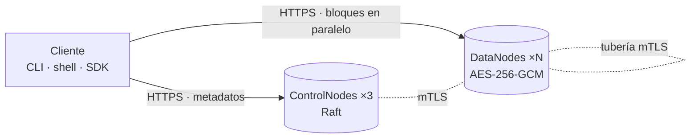

# DFSha — sistema de archivos distribuido con alta disponibilidad, rendimiento y seguridad

Proyecto 1 · ST0263 Tópicos Especiales en Telemática / SI3007 Sistemas Distribuidos · 2026-2
**Opción 1: Cliente/Servidor con servidor compuesto y distribuido (S2S).**

DFSha almacena **archivos grandes** partidos en **bloques inmutables y cifrados**, repartidos y
replicados entre varios DataNodes. Los **metadatos** viven en un grupo de ControlNodes replicado con
**Raft** (implementación propia), de modo que no hay punto único de fallo. El cliente ofrece una
abstracción de sistema de archivos jerárquico tipo Linux (`ls, cd, mkdir, rm, put, get, open/read/write,
lock…`) con transparencia de ubicación, replicación y fallos.



| Requisito del enunciado | Cómo lo cumple DFSha |
|---|---|
| Escalabilidad | bloques repartidos por política de colocación; E/S paralela; balanceador; metadatos con lecturas por *lease* |
| **Alta disponibilidad** | Raft ×3 (tolera 1 caída; 5 → 2), replicación ×3 de datos, re-replicación automática, *failover* de líder transparente |
| **Consistencia** | metadatos linealizables (Raft); bloques inmutables con SHA-256 extremo a extremo; commit atómico; close-to-open |
| **Particionamiento** | cada archivo en bloques; cada bloque en R nodos de ≥2 zonas |
| **Rendimiento / concurrencia** | transferencias paralelas por bloque, tubería de replicación, *read-ahead*, *group commit*, locks con *fencing* |
| **Seguridad** | TLS 1.2+ en todo, **mTLS** entre nodos con roles, cifrado en reposo AES-256-GCM con sobres de clave (los DataNodes no guardan la clave), usuario/clave + **2FA TOTP** + API keys, permisos POSIX + **ACL**, auditoría |
| **Transparencia** | `open()` tipo archivo; ubicación resuelta dinámicamente; *failover* entre réplicas y líderes invisible |
| RF1 / RF2 / RF3 | `ls/cd/mkdir/rmdir/rm/mv…` · `send()/receive()`, `put/get` · `open()/close()/read()/write()/lock()` |
| Infraestructura | nativo, Docker (compose con **aislamiento de claves por nodo**) o AWS Academy (scripts + validador automático de 10 pasos) |

## Inicio rápido (2 minutos, sin Docker)

```bash
brew install uv                                  # o: pipx install uv
uv sync --extra dev --extra report
uv run dfsha-cluster up --control 3 --data 5     # 3 ControlNodes + 5 DataNodes, TLS/mTLS reales
eval "$(uv run dfsha-cluster env)"
uv run dfsha login -u admin -p dfsha-admin-dev
uv run dfsha put README.md /home/admin/README.md
uv run dfsha blocks /home/admin/README.md        # mapa de bloques y réplicas por DataNode/zona
uv run dfsha nodes                               # estado de Raft y DataNodes
uv run dfsha-cluster kill leader                 # caos: matar al líder...
uv run dfsha ls /home/admin                      # ...y el servicio sigue
uv run dfsha-cluster destroy
```

SDK de Python:

```python
from dfsha.client.sdk import Client
c = Client(["https://127.0.0.1:8441"], "pki/ca.pem")
c.login("admin", "clave")
c.send(b"hola", "/home/admin/a.txt")               # RF2
with c.open("/home/admin/log.txt", "ab") as f:     # RF3
    f.write(b"nueva línea\n")
with c.lock("/home/admin/a.txt", "exclusive"):     # lock con lease + fencing token
    ...
```

## Documentación

| Documento | Contenido |
|---|---|
| [`docs/ESPECIFICACION.md`](docs/ESPECIFICACION.md) | definición del servicio, RF/RNF, alcance |
| [`docs/ARQUITECTURA.md`](docs/ARQUITECTURA.md) | componentes, flujos, escalabilidad |
| [`docs/API.md`](docs/API.md) | protocolos y APIs, algoritmos de particionamiento/distribución |
| [`docs/CONSISTENCIA.md`](docs/CONSISTENCIA.md) | replicación, consistencia, fallos |
| [`docs/SEGURIDAD.md`](docs/SEGURIDAD.md) | modelo de amenazas y controles |
| [`docs/OPERACION.md`](docs/OPERACION.md) | despliegue nativo/Docker/AWS, configuración, runbooks |
| [`docs/PRUEBAS.md`](docs/PRUEBAS.md) | estrategia y resultados de pruebas |
| [`docs/RESULTADOS.md`](docs/RESULTADOS.md) | benchmarks y análisis |
| [`deploy/aws/README.md`](deploy/aws/README.md) | runbook completo del despliegue en AWS Academy (con salidas esperadas y errores comunes) |
| [`docs/DESPLIEGUE_NUBE.md`](docs/DESPLIEGUE_NUBE.md) · [`docs/ESTADO_VERIFICACION.md`](docs/ESTADO_VERIFICACION.md) | resultados en la nube y qué está verificado (se regeneran con la evidencia) |
| `report/DFSha-Informe.docx` | informe técnico final |

## Configuración

Cada componente trae su ejemplo de variables (cópielo sin `.example`; las copias reales no se versionan):
`.env.example` (Docker Compose) · `.env.client.example` (cliente) · `deploy/aws/.env.example` (despliegue en AWS) ·
`docker/control.env.example` y `docker/data.env.example` (un ControlNode / un DataNode). Detalle en `docs/OPERACION.md`.

## Pruebas

```bash
uv run pytest                           # las 175 pruebas (≈6 min)
uv run pytest -m "not integration"      # unitarias (Raft, FSM, seguridad, colocación): segundos
uv run pytest tests/test_integration.py tests/test_cli.py   # cluster real con TLS/mTLS
uv run pytest tests/test_chaos.py       # caos: SIGKILL a líder/DataNodes, corrupción... (≈2 min)
uv run pytest tests/test_scale.py       # balanceo al añadir nodos, InstallSnapshot real
uv run python bench/bench.py all        # benchmarks reproducibles -> bench/results/
uv run python scripts/compose_dryrun.py # ensayo del docker-compose sin Docker (incluye aislamiento de claves)
uv run python scripts/docker_verify.py  # con Docker instalado: verificación de punta a punta + evidencia
uv run python scripts/check_entrega.py  # lista de verificación previa a la entrega
```

## Estructura

```
src/dfsha/{raft,control,data,client,security,common}   código del sistema
tests/  bench/  docs/  report/  docker/  deploy/aws/  docker-compose.yml
```

## Limitaciones declaradas

Membresía Raft estática; sin montaje a nivel de SO (FUSE); la rotación de `cluster.key` no está automatizada; un solo
grupo Raft limita la escala del *namespace*. **Estado de verificación:** todo el código y los 175 tests se ejecutan en
local con procesos reales (TLS/mTLS, SIGKILL); la imagen Docker y el despliegue en AWS **todavía no se han ejecutado**
(el compose se ensayó sin contenedores con `scripts/compose_dryrun.py`; los scripts de AWS se probaron con ejecutables
ejecutarlos, la evidencia se guarda sola y el informe pasa de «pendiente» a «verificado».
