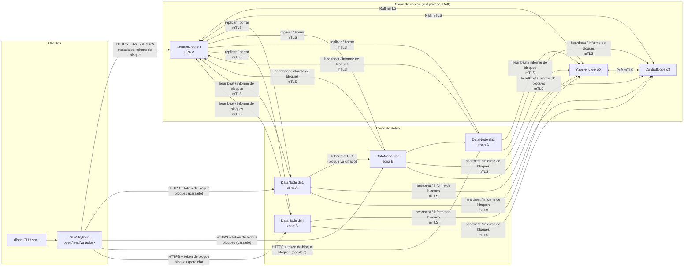
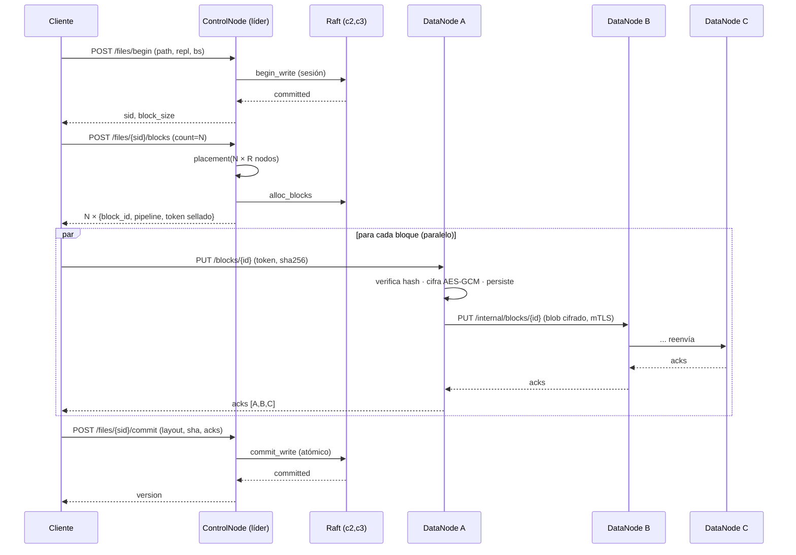
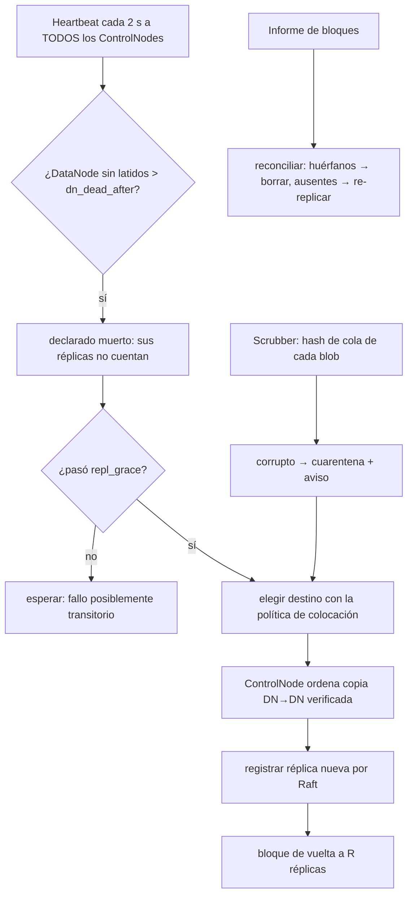

# Arquitectura de DFSha

## 1. Vista general

DFSha es un sistema de archivos distribuido **por bloques** con **arquitectura Cliente/Servidor**
(Opción 1) donde el servidor es un servicio compuesto: un **plano de control** replicado con Raft y un
**plano de datos** de nodos de almacenamiento. Los dos planos están separados a propósito: el consenso
sólo transporta metadatos y los bytes de los archivos fluyen directamente entre cliente y DataNodes.



### Componentes

| Componente | Código | Responsabilidad |
|---|---|---|
| Cliente / SDK | `client/sdk.py`, `client/fileobj.py` | Transparencia de acceso, ubicación y fallos; E/S paralela por bloque; verificación SHA-256 |
| CLI y shell | `client/cli.py` | Abstracción jerárquica tipo Linux |
| ControlNode | `control/node.py`, `api.py`, `monitor.py` | API de metadatos, autenticación, tokens de bloque, coordinación, reparación |
| Máquina de estados | `control/fsm.py` | Namespace, permisos/ACL, sesiones de escritura, bloques/réplicas, locks, usuarios (determinista) |
| Raft | `raft/core.py`, `raft/storage.py` | Elección de líder, replicación del log, snapshots, lecturas linealizables |
| Colocación | `control/placement.py` | Política de réplicas (zonas + balance) |
| DataNode | `data/node.py`, `store.py`, `api.py` | Bloques cifrados, tubería, informes, *scrubber* |
| Seguridad | `security/crypto.py`, `auth.py`, `pki.py` | AES-GCM, sobres de claves, tokens, TOTP, scrypt, CA propia |

## 2. Modelo de datos

```
Namespace (replicado por Raft)                 Datos (en DataNodes)
─────────────────────────────                 ─────────────────────
inode ─ dir  : nombre → inode                 bloque = blob cifrado
      └ file : [block_id, ...]  ← layout            MAGIC|ver|gen|nonce|AES-GCM(ct‖tag)|SHA-256
block_id → {len, sha256, réplicas:[dn…], repl}
file → {size, version, repl, block_size, DEK envuelta, owner/group/mode/ACL}
```

* **Bloque**: unidad de distribución, replicación, reparación y verificación. Tamaño por archivo
  (por defecto 4 MiB; configurable de 64 KiB a 256 MiB). Un bloque puede ser menor que el tamaño
  máximo (último bloque, anexos).
* **Inmutabilidad**: modificar un archivo = nuevos bloques + nuevo layout (ver `CONSISTENCIA.md`).

## 3. Flujos principales

### 3.1 Escritura (`put` / `open('wb')`)



Puntos clave:

* **Asignación por lotes**: una sola entrada Raft reserva hasta 512 bloques; el consenso no está en
  el camino caliente de los datos.
* **Tubería (como HDFS)**: el cliente sube *una* copia; los DataNodes reenvían. El ancho de banda de
  subida del cliente no se multiplica por R y el blob viaja ya cifrado (los siguientes nodos jamás ven
  texto claro ni la clave).
* **Tolerancia a fallos**: si el primer nodo no responde, el cliente entra por la posición siguiente
  de la tubería; si hay menos de W confirmaciones pide **reubicación** excluyendo los nodos fallidos.

### 3.2 Lectura (`get` / `open('rb')`)

1. `GET /files/locations`: el líder verifica permisos y devuelve, por bloque, las réplicas **vivas
   primero** (misma zona primero) y un token de lectura sellado.
2. El cliente descarga los bloques **en paralelo** (o con *read-ahead* en `open`), verifica el SHA-256
   del texto claro y, si una réplica falla o está corrupta, **conmuta a otra** de forma transparente
   (refrescando ubicaciones y tokens si hace falta).

### 3.3 Elección de líder y *failover*

Si el líder cae, un seguidor vence su temporizador aleatorio, hace **Pre-Vote**, gana la elección y
registra una entrada *no-op* que le permite comprometer el término. El cliente recibe `ENOTLEADER`
(con pista del nuevo líder) o un error de conexión y reintenta con **el mismo `X-Request-Id`**, de modo
que una operación ya comprometida no se ejecute dos veces.

### 3.4 Autorreparación



## 4. Escalabilidad por diseño

| Dimensión | Mecanismo |
|---|---|
| Tamaño de archivo | Bloques; el archivo crece añadiendo bloques (anexar/COW). Sin límite impuesto por un nodo |
| Nº de archivos | Metadatos en memoria (RAM del ControlNode) + snapshots/compactación del log; **medido**: ≈0,8 KiB por archivo + ≈0,5 KiB por bloque (≈0,01 % del dato con bloques de 4 MiB) |
| Ancho de banda | Los datos no pasan por el plano de control; E/S **paralela** por bloque entre muchos DataNodes; escala con nº de nodos |
| Capacidad | Añadir un DataNode: se registra solo, recibe nuevas escrituras y el **balanceador** migra réplicas desde nodos llenos sin reducir redundancia |
| Lectura de metadatos | Lecturas linealizables con *lease* sin RPC; lecturas relajadas servibles por cualquier ControlNode |
| Escritura de metadatos | *Group commit* (un `fsync` por lote de entradas) y asignación de bloques por lotes |
| Usuarios concurrentes | Servidores asíncronos (asyncio/uvicorn); E/S de disco y criptografía en hilos; semáforos de carga por DataNode |

La escalabilidad **del plano de control** (cuántos metadatos caben y cuántas operaciones/s) está
limitada por un único grupo Raft; es el mismo compromiso de HDFS/GFS (la federación o el *sharding* del
namespace sería el siguiente paso; ver "Trabajo futuro" en el informe).

## 5. Estructura del repositorio

```
src/dfsha/
  raft/        core.py (Raft) · storage.py (log, snapshot, meta durables)
  control/     fsm.py · node.py · api.py · monitor.py · placement.py · config.py · main.py
  data/        store.py · node.py · api.py · config.py · main.py
  client/      sdk.py · fileobj.py · cli.py · session.py
  security/    crypto.py · auth.py
  common/      errors.py · net.py (mTLS/uvicorn) · util.py
  pki.py · cluster.py
tests/         unitarios, integración y caos
bench/         benchmarks reproducibles
docker/ · docker-compose.yml · deploy/aws/
docs/
```
